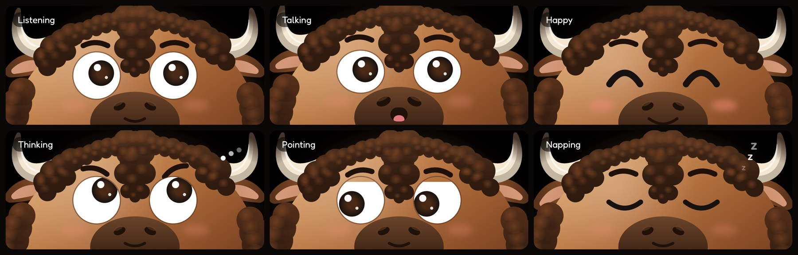
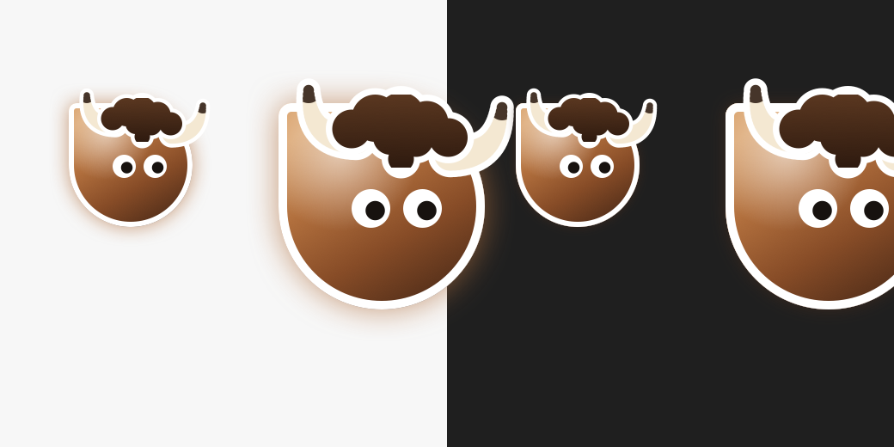
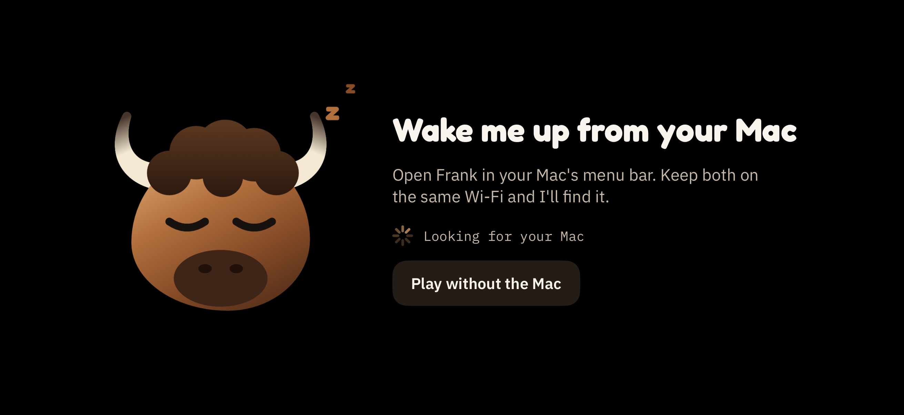

<div align="center">

# Frank 🦬

**A little brown bison who lives on your iPhone, right under your Mac's screen.**<br>
He listens while you work, looks at what you're looking at, points at things with his own big cursor,<br>
and, when you ask, clicks and types for you.


[How it works](#how-it-works) · [Getting started](#getting-started) · [Using Frank](#using-frank) · [Privacy and safety](#privacy-and-safety) · [Contributing](#contributing)

</div>

---

## What is Frank?

Prop your iPhone up under your Mac's screen and Frank peeks up from the bottom of it. He's a desk buddy you can talk to:

- **Ask about anything on screen.** Hold the phone's screen and ask "what's this?" Frank looks at your Mac's screen and answers in a speech bubble next to his cursor.
- **He points at things.** His big bison cursor flies across your Mac to show you exactly where a button, a word or a setting is.
- **He uses the computer for you, if you let him.** Clicking, typing, keyboard shortcuts, scrolling, dragging, opening apps and websites. He does it with his own cursor and puts your real pointer back where you left it.
- **He looks things up.** Ask a question that needs the web and he researches it and shows a short report card.
- **He listens quietly, on the device.** While he's awake the iPhone turns everything you say into text with on-device Whisper (Danish and English), and that becomes context. Audio never leaves the phone. He only answers when you hold the screen, and never talks out loud: replies are text, with a little cartoon chirp from the phone.
- **He has feelings.** Listening, talking, happy, thinking, pointing, sleepy and napping, with darting eyes, blinks, hops and a forelock that bobs with his brows.



<table>
<tr>
<td width="50%"></td>
<td width="50%"></td>
</tr>
<tr>
<td align="center"><sub>His cursor on your Mac, on light and dark backgrounds</sub></td>
<td align="center"><sub>Asleep on the phone until it finds your Mac</sub></td>
</tr>
</table>

## How it works

Frank is two apps that find each other on your Wi-Fi:

- **The iPhone app** is his face and ears. It draws Frank and turns what you say into text on the device.
- **The Mac menu bar app** is his brain and hands. It holds your OpenAI key, talks to the model, sees the screen, draws his cursor and speech bubbles, and does the clicking and typing.

```
 iPhone (face and ears)                      Mac (brain and hands)
 ──────────────────────                      ─────────────────────
 mic ─► Whisper (on device) ─► text ───────► gpt-6-luna (Responses API) ◄─► tools: look, point,
                                                                              research, press, click, type
 chirp + transcript ◄──── replies ──────────  speech bubble by his cursor
        └──── Bonjour (_frank._tcp), newline JSON over TCP ────┘
```

1. While Frank is awake, the phone splits what you say into phrases, transcribes them with Whisper on the device (optionally cleaned up by a small local language model) and sends the text to the Mac as background. Frank doesn't reply yet.
2. When you hold the screen, everything you say until you let go is your question. The phone transcribes it straight away and sends it to the Mac.
3. The Mac asks the model, which answers or calls tools. Tools run right there on the Mac: it reads the screen (text, controls and a screenshot), points, researches, or uses the computer, then hands the result back. This loops (look, act, check) until he has his answer, up to 24 steps per question.
4. His reply streams into a speech bubble by his cursor, and the phone chirps and saves it in the session's transcript.

### Models

| What | Model | Where it runs |
| --- | --- | --- |
| Speech to text | Whisper Small or Whisper Large v3 Turbo ([WhisperKit](https://github.com/argmaxinc/argmax-oss-swift)) | On the iPhone |
| Transcript cleanup (optional) | Qwen2.5 1.5B Instruct, 4-bit ([MLX](https://github.com/ml-explore/mlx-swift-lm)) | On the iPhone |
| Frank himself (answers, tools, using the computer) | `gpt-6-luna` (Responses API) | OpenAI, called from the Mac |
| Web research reports | `gpt-6-luna` with web search | OpenAI, called from the Mac |

The on-device models are downloaded inside the app (**Frank → Ears**), not bundled. The OpenAI models are set in `Mac/Voice/Brain.swift` and `Mac/Voice/WebResearch.swift`.

## Getting started

### What you need

- A Mac on macOS 14 or later
- An iPhone on iOS 17 or later, on the same Wi-Fi as the Mac
- Xcode (for the iPhone app) and an Apple developer account to sign it
- An [OpenAI API key](https://platform.openai.com/api-keys)

### 1. Run the Mac app

Open `Frank.xcodeproj`, pick the **FrankMac** scheme and press Run. Or build it without Xcode, using just the Command Line Tools:

```sh
./scripts/build-mac.sh
open build/Frank.app
```

Frank's head appears in the menu bar. Choose **OpenAI Key…** and paste your key. macOS will ask for **Screen Recording** (so he can see the screen) and, if you want him to click and type, **Accessibility**.

### 2. Run the iPhone app

In `Frank.xcodeproj`, pick the **Frank** scheme, choose your team under **Signing & Capabilities**, and run it on your iPhone. Allow the microphone and local network when asked. The phone finds the Mac by itself.

The first time you wake him, Frank asks to download his ears: Whisper Small (490 MB). In **Frank → Ears** you can switch to Whisper Large v3 Turbo for better Danish, pick your language, and download the optional cleanup model (880 MB). The cleanup model needs a real iPhone with 6 GB of memory or more; it can't run in the Simulator.

> [!NOTE]
> Both apps ship with the bundle IDs `com.jakobsendevelopment.frank.mac` and `.phone`. If you're building your own copy, change them in Xcode (or `project.yml`) to IDs under your own team.

## Using Frank

### On the phone

| Gesture | What it does |
| --- | --- |
| Double tap | Wake him up to talk, or put him back to sleep |
| Press and hold | Ask him something; let go and he answers |
| Faint speaker button, top right | Chirp volume, a test hi, and which Mac to pair with |
| Faint grid button, next to it | Start or end a session, and see past sessions with their transcripts |

### On the Mac

These shortcuts work from any app:

| Keys | What it does |
| --- | --- |
| ⌥Space | Wake him up to talk, or back to follow mode |
| ⌃⌥P | Fly to the mouse and point there |
| ⌃⌥F | Eyes follow the mouse, on or off |
| ⌃⌥D | Stop pointing and go home, above the phone |
| ⌃⌥T | Talk test (the phone bounces for 3 seconds) |
| ⌃⌥H | Hide or show his cursor |
| ⌃⌥S | Stop him using the computer |

The menu bar also has his mood, cursor size (48 to 120 pt), pointer trail, cursor glow, where the phone sits under the screen (left, center, right), and **Personality…**, where you can rewrite who he is.

## Privacy and safety

- **Your OpenAI key stays on your Mac**, in `~/Library/Application Support/Frank/keys.json`, readable only by your user. Only the Mac talks to OpenAI; the phone never sees the key.
- **Audio never leaves your iPhone.** Speech is transcribed on the device. What goes to OpenAI is the resulting text, screenshots and on-screen text when he looks at the screen, and your questions when he researches something. Model downloads come from Hugging Face. Nothing goes anywhere else.
- **Using the computer is opt-in.** It needs Accessibility permission, and you can switch it off any time with **Let Him Use the Computer** in the menu. He only acts when you ask, confirms before anything hard to undo, treats text on screen as information rather than instructions, refuses password fields and logout, lock and force-quit shortcuts, and stops instantly on ⌃⌥S.
- **Session transcripts stay on your phone.**

## Contributing

Issues and pull requests are welcome. The code is plain Swift and SwiftUI. The Mac app has no dependencies; the iPhone app uses WhisperKit, MLX Swift LM, swift-huggingface and swift-transformers via Swift Package Manager.

```
Mac/                  menu bar app
  App/                launch, menu, settings, shortcuts, API keys, fonts
  Character/          his cursor, speech bubbles and research report card
  Voice/              his brain (Responses API loop), instructions, tools and web research
  Computer/           reading the screen and controls, clicking and typing
  Link/               the server the phone connects to
iOS/                  iPhone app (SwiftUI)
  App/                app entry, pairing screen, sound button
  Face/               Frank the bison and his animated face
  Ears/               on-device speech recognition, transcript cleanup and model downloads
  Voice/              the session on the phone: listening, asking, chirps
  Sessions/           session history and transcripts
  Link/               finding and talking to the Mac
Shared/               pairing protocol and colors, used by both apps
Shared/Fonts/         Fredoka and IBM Plex
scripts/build-mac.sh  builds the Mac app without Xcode
scripts/make-icons.sh draws both app icons from Frank's face code
docs/images/          the pictures in this README
```

- `Frank.xcodeproj` has both apps: **Frank** is the iPhone app and **FrankMac** the Mac app. `Package.swift` builds the Mac app for `scripts/build-mac.sh`.
- `Frank.xcodeproj` is generated from `project.yml` with [XcodeGen](https://github.com/yonaskolb/XcodeGen). After adding files or changing settings, edit `project.yml` and run `xcodegen generate`.
- Frank's face is drawn in code (`iOS/Face/FaceView.swift` and `BisonParts.swift`) on an 844 × 390 design canvas, and every expression comes from `FaceAnimator`. The app icons are drawn from the same code: after changing him, run `./scripts/make-icons.sh`.

## License

Public domain under [the Unlicense](LICENSE). Do whatever you want with Frank.
